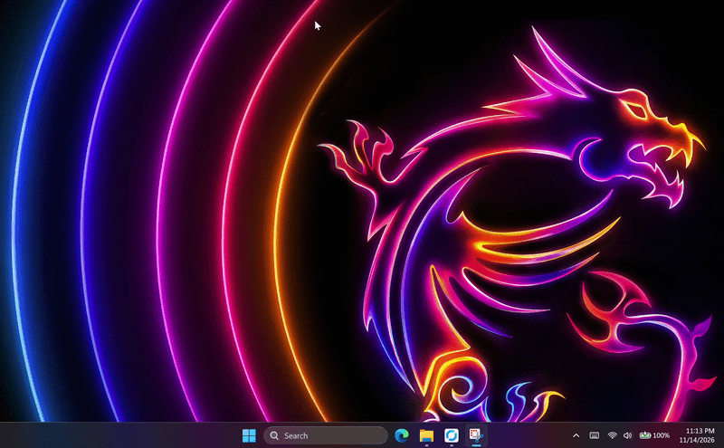

<p align="center">
  
</p>

<h3 align="center">Tsume</h3>

<p align="center">
  A fast, lightweight, open source OEM software replacement for handheld gaming PCs.
</p>

<p align="center">
  
</p>

<br>

<p align="center">
  <a href="https://discord.gg/sPyKF2WHmb"></a>
</p>

## Features

#### Performance & Power
- Firmware performance modes (`Endurance`, `Balanced`, `Performance`, `Manual`) with customizable presets and CPU Boost toggle
- Fan control (`Auto`, or three custom fan curves with thermal safety floors)
- Battery charge limit (`80%`, `90%`, or `100%`), kept across sleep and restarts
- Live CPU temperature, fan speed, power limits, battery level, and clock

#### Gaming & Overlays
- **Opens over anything:** games, desktop, Xbox Full Screen Experience (FSE), and Steam Big Picture
- **OptiScaler manager:** install, update, repair, or cleanly remove OptiScaler across your game libraries (plus custom games). Downloads nightly builds and `OptiPatcher`, and supports `XeSS`, `FSR 4`, `FSR 3`, `FSR 4.1.2 XMX` (on Intel XMX GPUs), frame generation, FPS limiting, and anti-cheat warnings
- **RTSS overlay & FPS limiter:** four sizes (`FPS`, `Bar`, `Detail`, `Full`) that apply instantly in-game (Tsume can install RTSS for you or link to the official download)

#### Controls & Lighting
- Switch the built-in controller between gamepad and cursor (mouse) mode
- Remap `M1` and `M2` back buttons, and configure the `M` and Quick Settings buttons
- **RGB lighting:** `Off`, `Steady`, `Breathe`, `Rainbow`, or `Spin` for the stick rings and ABXY buttons with per-stick colors, brightness, and speed

#### System & Personalization
- Display brightness, refresh rate switcher, and speaker volume/mute
- **Quick actions:** touch keyboard, screenshot, Task Manager, show desktop, Steam Big Picture, and Xbox Game Bar
- **Power menu:** hibernate, lock, restart, and shut down
- **Customizable main panel tiles:** pick and reorder the quick tiles you want
- **Themes:** eight built-in presets, or custom accent, background, and text colors

<details>
<summary><b>Supported devices</b></summary>

✅ Tested &nbsp;&nbsp; 🟠 Beta

| | Device | Chip | Board |
|---|---|---|---|
| ✅ | MSI Claw 8 EX AI+ | Intel Arc G3 Extreme | MS-1T91 |
| 🟠 | MSI Claw 8 EX AI+ | Intel Arc G3 | MS-1T91 |
| 🟠 | MSI Claw A8 | AMD Ryzen Z2 Extreme | MS-1T8K |
| 🟠 | MSI Claw 8 AI+ | Intel Core Ultra 7 258V | MS-1T52 |
| 🟠 | MSI Claw 7 AI+ | Intel Core Ultra 7 258V | MS-1T42 |
| 🟠 | MSI Claw A1M | Intel Core Ultra 5 135H / Ultra 7 155H | MS-1T41 |

On these, Tsume replaces MSI Center M and its Game Bar Quick Settings widget.

Tsume is built so that more devices can be added. On a machine it does not know
yet, the panel runs but leaves the firmware alone.

</details>

<details>
<summary><b>Install</b></summary>

1. Download `Tsume-<version>-x64.msi` from the Releases page and run it.
   If Windows SmartScreen pops up, click `More info`, then `Run anyway` (the installer is unsigned).
2. Open Tsume from the Start menu.
3. Open `Settings` (gear icon) and turn on `Start with Windows`.
   - On an MSI Claw, also turn on `Pause MSI Center M` so the `M` button opens Tsume.

You can also open or close the panel anytime with `View + Menu` (controller) or `Win + Alt + Q` (keyboard).

### Uninstall

Remove Tsume from Windows `Installed apps`. If you installed OptiScaler in any games, it will ask whether to remove it. It also restores your previous RTSS overlay settings and re-enables MSI Center M if it was paused.

> If MSI Center M still doesn't run after uninstalling, open `Task Scheduler`, enable `MSI_Center_M_Server` and `MSI_Center_M_Updater` in the library, then right-click `MSI_Center_M_Server` and click `Run`.

</details>

<details>
<summary><b>Safety</b></summary>

#### No kernel drivers
Tsume talks to your hardware through the BIOS's built-in WMI interface (and standard HID for controller lighting and buttons), with no custom drivers or raw register writes.

#### Isolated helper service
The panel never runs as administrator. Hardware calls go through the `Tsume.Helper.exe` Windows service, which only accepts a fixed set of commands and clamps every value to safe limits.

#### Known devices only
On an unrecognized board, Tsume will not write anything to firmware.

#### Non-destructive
No manufacturer software is deleted. Pausing MSI Center M only disables its two scheduled tasks and stops its processes; resuming reverses both.

</details>

<details>
<summary><b>Building</b></summary>

Requires the [.NET 10 SDK](https://dotnet.microsoft.com/download/dotnet/10.0) (`10.0.400` or newer).

#### Build and open the panel
```powershell
powershell -ExecutionPolicy Bypass -File tools\run.ps1
```

#### Build the installer
```powershell
powershell -ExecutionPolicy Bypass -File tools\publish.ps1
```

The installer is saved to `artifacts\installer\` and bundles the panel, the helper service, and the .NET runtime. Builds are unsigned unless you pass `-Certificate <thumbprint>`. See [installer/Package.wxs](installer/Package.wxs) for everything setup does.

#### Read-only firmware probe
Running the panel directly without installing the helper service still opens the UI, but firmware controls won't apply. To inspect what your firmware reports without writing anything (one UAC prompt):

```powershell
powershell -ExecutionPolicy Bypass -File tools\probe.ps1
```

</details>

## License

Tsume is free software: you can redistribute it and/or modify it under the terms
of the GNU General Public License, version 3, as published by the Free Software
Foundation. It comes with no warranty. See [LICENSE](LICENSE).

*Tsume is developed with the assistance of AI.*
